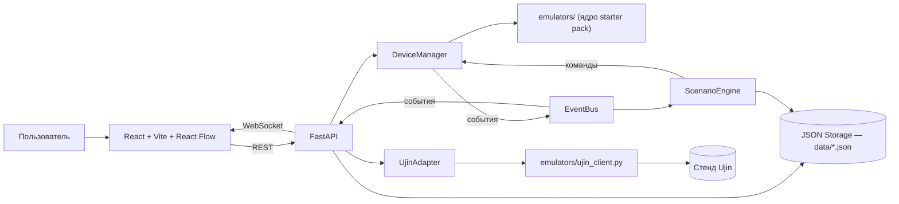

# Ujin Smart Lab

Ujin Smart Lab — локальный симулятор умных домов, зданий и комплексов с использованием эмуляторов оборудования и устройства на базе платформы UjinOS. В нём можно смотреть на устройства из starter pack, менять их управляемые сигналы, собирать виртуальные устройства в Конструкторе и связывать устройства сценариями вида «если случилось А, сделай Б».


<a id="requirements"></a>
 Требования
| Компонент | Версия | Для чего |
|---|---|---|
| Python | 3.10 или новее | backend (FastAPI) |
| Node.js | 20 или новее | frontend (Vite + React) |
| Git | любая | скачать проект |
| ОС | Windows 10/11, macOS, Linux | — |
| Браузер | современный (Chrome, Edge, Firefox) | интерфейс |

> [!NOTE]
> Видеокарта, Docker и облачные сервисы **не нужны**. Интернет требуется только для установки зависимостей и для режима LIVE. Режим LOCAL работает без сети и без учётных данных Ujin.

<a id="features"></a>
##  Основные возможности
-  **Виртуальные устройства из starter pack** — датчик протечки, светильник, термостат, шлагбаум, счётчик
-  **Управление в реальном времени** — переключатели, ползунки, числовые поля, кнопки
-  **Имитация событий** — «сымитировать протечку», «препятствие под шлагбаумом» и другие
-  **Конструктор устройств** — свои устройства из набора сигналов, без кода
-  **Редактор сценариев** — триггер → условия → действия, с наглядной схемой на React Flow
-  **Журнал выполнения** — каждый шаг сценария записывается и показывается на сайте
-  **Живые обновления через WebSocket** — страницу не нужно перезагружать
-  **LIVE-режим** — отправка команд и сценариев на стенд Ujin (по желанию)
-  **Хранение в JSON-файлах с атомарной записью** — данные не пропадают при перезапуске
   
<a id="quick-start"></a>
## Быстрый старт

Нужны два терминала: один для backend, второй для frontend.

### 1. Скачать проект

```bash
git clone https://github.com/qcawaa/hackathon_smart_home.git
cd hackathon_smart_home
```

> [!IMPORTANT]
> Папки `backend`, `emulators` и `data` должны лежать рядом, в корне проекта.
> Backend подключает готовые устройства из `emulators`, поэтому переносить
> `backend` отдельно нельзя.

### 2. Запустить backend (терминал 1)

<details>
<summary> Windows (PowerShell)</summary>

```powershell
cd backend
python -m venv .venv
.\.venv\Scripts\Activate.ps1
pip install -r requirements.txt
uvicorn app.main:app --reload --app-dir .
```

</details>

<details>
<summary> Linux / macOS</summary>

```bash
cd backend
python3 -m venv .venv
source .venv/bin/activate
pip install -r requirements.txt
uvicorn app.main:app --reload --app-dir .
```

</details>

Backend доступен на `http://localhost:8000`.
Проверка: откройте `http://localhost:8000/api/health` — должно быть `{"ok": true, ...}`.

### 3. Запустить frontend (терминал 2)

```bash
cd frontend
npm install
npm run dev
```

Откройте http://localhost:5173.

### Остановка
В каждом терминале нажмите `Ctrl + C`.

<a id="modes"></a>
## Режимы LOCAL и LIVE
| | LOCAL | LIVE |
|---|---|---|
| Нужна сеть | нет | да |
| Нужны доступы Ujin | нет | да (`UJIN_UST`, `UJIN_APARTMENT_ID`) |
| Где живут устройства | на вашем компьютере | локально + команды на стенд Ujin |
| Для чего | разработка, демо, сценарии | проверка связи с платформой |

Режим определяется автоматически: если в `backend/.env` заданы `UJIN_UST` и `UJIN_APARTMENT_ID`, доступен LIVE, иначе работает LOCAL.

В LIVE доступны:

- чтение устройства с платформы и отправка ему команды;
- список сценариев на платформе;
- кнопка **Сценарии → В LIVE**, которая переводит совместимый сценарий в формат Ujin Autoscripts.

> [!WARNING]
> Стендовые ограничения: на тестовом стенде часть возможностей
> (WebSocket-доставка команд, управляемые словари, автосценарии)
> может быть отключена организаторами. Подробности в
> [P5-UJIN-INTEGRATION.md](P5-UJIN-INTEGRATION.md). На LOCAL-режим это не влияет.

<a id="tech-stack"></a>
## Технологический стек

- **Backend** — Python 3.10+, FastAPI, Uvicorn, Pydantic, python-dotenv
- **Frontend** — Vite, React 19, TypeScript, Ant Design, React Flow (`@xyflow/react`)
- **Данные** — JSON-файлы в папке `data/` (атомарная запись через временный файл)
- **Эмуляторы** — ядро starter pack в папке `emulators/` (классы `Device` и `Signal`, клиент Ujin)

<a id="configuration"></a>
## Конфигурация

Настройки backend лежат в файле `backend/.env`. Создайте его из шаблона:

**Linux / macOS:**

```bash
cp backend/.env.example backend/.env
```

**Windows:**

```powershell
Copy-Item backend\.env.example backend\.env
```

| Переменная | По умолчанию | Назначение |
|---|---|---|
| `UJIN_BASE_URL` | `https://api-uae-test.ujin.tech` | адрес стенда Ujin |
| `UJIN_UST` | пусто | токен доступа (для LIVE) |
| `UJIN_APARTMENT_ID` | пусто | номер тестовой квартиры (для LIVE) |
| `UJIN_MODEL_CLASS` | `integrations_devices` | класс устройств для публикации сигналов |
| `APP_DATA_DIR` | `data/` в корне проекта | папка с JSON-файлами |
> [!CAUTION]
> `UJIN_UST` — это секрет. Храните его только в `backend/.env` и
> **никогда не добавляйте файл `.env` в репозиторий**. После изменения `.env`
> перезапустите backend.

### Адреса и порты

| Что | Адрес |
|---|---|
| Сайт (frontend) | `http://localhost:5173` |
| API (backend) | `http://localhost:8000/api` |
| Документация API (Swagger) | `http://localhost:8000/docs` |

Адрес API задан в `frontend/src/api.ts`, а разрешённый адрес сайта (CORS) — в `backend/app/main.py`. Если меняете порты, поменяйте их в обоих местах.

<a id="devices"></a>
## Устройства

При запуске создаются пять готовых устройств:

| ID | Устройство | Что умеет |
|---|---|---|
| `leak_1` | Датчик протечки | протечка, батарея, вскрытие корпуса, самотест |
| `light_1` | Светильник | вкл/выкл, яркость, мощность, энергия, авто-выключение по таймеру |
| `thermostat_1` | Термостат | целевая температура, режимы, гистерезис ±0,5 °C |
| `barrier_1` | Шлагбаум | открыть/закрыть, авто-закрытие, реверс при препятствии, авария |
| `counter_1` | Счётчик | показания растут сами, реле нагрузки |

Каждый сигнал устройства имеет режим:

| Режим | Значение |
|---|---|
| `r` | только чтение (датчики) |
| `rw` | чтение и управление (переключатели, ползунки, настройки) |
| `w` | только команда (кнопки) |

Менять можно только сигналы с режимом `rw` и `w`.

### Конструктор

В разделе **Конструктор** можно создать своё устройство: задать название и список сигналов (имя, тип, режим, границы, единицы измерения). Устройство сохраняется в `data/generic_devices.json` и сразу появляется в списке.

- Имя сигнала: латинские буквы, цифры и `_`, начинается с буквы, до 40 символов, не `fw`.
- Имена сигналов внутри одного устройства не должны повторяться.
- Универсальное устройство не меняется само по себе: значения меняются только по командам и сценариям.

В папке `emulators/devices/` есть и другие семейства (вентиляция, пожарный датчик, лифт, хаб протечки). По умолчанию они не добавлены в приложение. Новое семейство можно создать генератором `python emulators/new_device.py <имя>`.

<a id="scenarios"></a>
## Сценарии

Сценарий состоит из трёх частей:

1. **Триггер** — событие, которого ждём (`leak = 1`).
2. **Условия** (необязательно) — дополнительные «если» по текущему состоянию устройств.
3. **Действия** — что сделать (`lamp = 1`).

### Как исполняется сценарий

1. Устройство меняет сигнал, `DeviceManager` публикует событие в `EventBus`.
2. `ScenarioEngine` получает событие и ищет включённые сценарии с подходящим триггером.
3. Сценарий запускается **один раз** в момент перехода «условие не выполнялось → выполнилось».
4. Проверяются условия, затем выполняются действия.
5. Каждый шаг записывается в журнал (последние 100 записей) и приходит на сайт по WebSocket.

### Ограничения кнопки «В LIVE»

Ujin Autoscripts понимает только простые правила, поэтому на платформу уходят сценарии вида «если сигнал равен значению, то установить сигнал»: оператор `==`, без условий, одно действие.

<a id="architecture"></a>
## Архитектура

    
**Что за что отвечает:**
| Часть | Роль |
|---|---|
| `DeviceManager` | Хранит устройства, выполняет команды и имитации, каждую секунду «двигает время» |
| `EventBus` | Рассылает события «что-то изменилось» всем подписчикам |
| `ScenarioEngine` | Слушает события и выполняет сценарии, ведёт журнал |
| `GenericDevice` | Превращает устройство из Конструктора в объект, с которым работает остальной код |
| `Storage` | Читает и пишет JSON-файлы (запись через временный файл) |
| `UjinAdapter` | Мост к платформе Ujin, работает только если заданы доступы |
| `scenario_compiler` | Переводит сценарий в формат Ujin Autoscripts |

<a id="project-structure"></a>
##  Структура проекта
```text
hackathon_smart_home/
├── backend/                         # FastAPI приложение
│   ├── app/
│   │   ├── main.py                  # точка входа, все адреса API и WebSocket
│   │   └── services/
│   │       ├── device_manager.py    # устройства, команды, тики времени
│   │       ├── generic_device.py    # устройство из Конструктора
│   │       ├── event_bus.py         # шина событий
│   │       ├── scenario_engine.py   # исполнение сценариев и журнал
│   │       ├── scenario_compiler.py # перевод в Ujin Autoscripts
│   │       ├── storage.py           # JSON-хранилище
│   │       └── ujin_adapter.py      # связь с платформой Ujin
│   ├── .env.example                 # шаблон настроек
│   └── requirements.txt
│
├── frontend/                        # React + Vite + TypeScript
│   └── src/
│       ├── main.tsx                 # точка входа, тема Ant Design
│       ├── App.tsx                  # страницы и компоненты
│       ├── api.ts                   # запросы к backend и адрес WebSocket
│       └── styles/
│           ├── index.css            # основные стили
│           └── ux.css               # UX-стили
│
├── emulators/                       # ядро starter pack
│   ├── core.py                      # Signal, Device, веб-панель устройства
│   ├── ujin_client.py               # клиент API Ujin
│   ├── main.py                      # запуск одного устройства из командной строки
│   ├── live_loop.py                 # приём команд платформы (опрос)
│   ├── ws_client.py                 # WebSocket-клиент по контракту мобильного приложения
│   ├── new_device.py                # генератор заготовки нового устройства
│   └── devices/                     # leak, light, thermostat, barrier, counter и др.
│
├── data/                            # runtime-данные (в .gitignore)
│   ├── generic_devices.json         # устройства Конструктора
│   └── scenarios.json               # сценарии
│
├── docs/                            # документация
│   ├── START.md                     # быстрый старт со starter pack
│   ├── DEMO.md                      # сценарий демонстрации
│   ├── SCENARIOS.md                 # сценарии и автоскрипты
│   ├── P5-UJIN-INTEGRATION.md       # интеграция с Ujin (LIVE)
│   ├── PULL-CLIENT.md               # приём команд с платформы
│   ├── STARTER-PACK.md              # материалы starter pack
│   ├── api-methods.md               # методы API Ujin
│   ├── protocol-porting.md          # перенос протоколов
│   └── UJIN-REQUIRED-SIGNALS.json   # необходимые сигналы Ujin
│
├── .env.example                     # (опционально) общий шаблон
├── .gitignore
├── pyproject.toml
└── README.md                        # этот файл
```

<a id="tests"></a>
Проверки
```bash
# тесты эмуляторов (без сети)
cd emulators
python -m unittest discover -s tests

# тесты backend
cd ../backend
python -m pytest

# сборка frontend
cd ../frontend
npm run build
```

<a id="troubleshooting"></a>
## Частые ошибки и решения
<details>
<summary>PowerShell не даёт активировать виртуальное окружение</summary>
  
**Признак:** «выполнение сценариев отключено в этой системе».
**Решение:** разрешите скрипты только для текущего окна и повторите активацию:
```powershell
Set-ExecutionPolicy -Scope Process -ExecutionPolicy Bypass
.\.venv\Scripts\Activate.ps1
```
</details>

<details>
<summary>ModuleNotFoundError: No module named 'app'</summary>
  
**Причина:** uvicorn запущен не из папки `backend` или без `--app-dir .`.
**Решение:**
```bash
cd backend
uvicorn app.main:app --reload --app-dir .
```
</details>

<details>
<summary>ModuleNotFoundError: devices / core / ujin_client</summary>
  
**Причина:** backend не нашёл папку `emulators`. Он ищет её в корне проекта рядом с `backend`.
**Решение:** не переносите `backend` отдельно, сохраняйте структуру папок как в репозитории.

</details>

<details>
<summary>Сайт открывается, но данных нет или появляется «Не удалось выполнить запрос»</summary>

Проверьте по порядку:
1. Запущен ли backend: откройте `http://localhost:8000/api/health`.
2. Открыт ли сайт именно по адресу `http://localhost:5173`. Backend разрешает запросы только с него, поэтому открытие по IP-адресу или на другом порту блокируется браузером (CORS).
3. Совпадают ли адреса в `frontend/src/api.ts` и в `backend/app/main.py`, если вы меняли порты.
</details>

<details>
<summary>Порт 8000 или 5173 уже занят</summary>

**Решение для backend:**
```bash
uvicorn app.main:app --reload --app-dir . --port 8001
```
Затем замените `8000` на `8001` в `frontend/src/api.ts` (адреса `API` и `wsUrl`).
Если занят порт 5173, закройте программу, которая его использует: иначе Vite выберет другой порт, а backend его не разрешит.

</details>

<details>
<summary>Сценарий не срабатывает</summary>

Проверьте по порядку:
1. Сценарий включён.
2. В триггере совпадают устройство, сигнал и значение.
3. Сценарий срабатывает только при переходе «условие не выполнялось → выполнилось». Верните датчик в исходное состояние и повторите.
4. Если есть условия, они выполняются в момент события.
5. Откройте журнал: там видно, на каком шаге остановился сценарий («Условие не выполнено», «Ошибка действия»).
</details>

<details>
<summary>LIVE_NOT_CONFIGURED: «Для LIVE настройте доступы»</summary>

**Причина:** в `backend/.env` не заданы `UJIN_UST` и `UJIN_APARTMENT_ID`.

**Решение:** заполните оба значения и перезапустите backend. Для работы без платформы LIVE не нужен.

</details>

<details>
<summary>Кнопка «В LIVE»: «Ujin Autoscripts поддерживает только простое равенство»</summary>

**Причина:** сценарий слишком сложный для автоскриптов Ujin.
**Решение:** оставьте в сценарии оператор `==`, уберите условия и оставьте одно действие.
</details>
<details>
<summary>Нужно сбросить все устройства и сценарии</summary>
Остановите backend и удалите файлы `data/generic_devices.json` и `data/scenarios.json`. При следующем запуске они создадутся пустыми.
> [!WARNING]
> Все созданные вами устройства и сценарии будут потеряны.
</details>

<a id="documentation"></a>
## Документация

Интерактивная документация API (после запуска backend): http://localhost:8000/docs

Материалы проекта в папке `docs/`:

| Файл | О чём |
|---|---|
| [START.md](docs/START.md) | быстрый старт со starter pack |
| [DEMO.md](docs/DEMO.md) | сценарий демонстрации |
| [SCENARIOS.md](docs/SCENARIOS.md) | сценарии и автоскрипты |
| [P5-UJIN-INTEGRATION.md](docs/P5-UJIN-INTEGRATION.md) | интеграция с Ujin (LIVE): запуск, контракты, ограничения стенда |
| [PULL-CLIENT.md](docs/PULL-CLIENT.md) | приём команд с платформы (опрос) |
| [STARTER-PACK.md](docs/STARTER-PACK.md) | материалы starter pack |
| [api-methods.md](docs/api-methods.md) | методы API Ujin |
| [protocol-porting.md](docs/protocol-porting.md) | перенос протоколов |
| [UJIN-REQUIRED-SIGNALS.json](docs/UJIN-REQUIRED-SIGNALS.json) | необходимые сигналы Ujin |

Проект переиспользует устройства, `Signal`/`Device`, публикации, WebSocket-клиент и контракт Ujin API из starter pack. Токены и файлы с доступами в репозиторий не входят.


**kepka** · хакатон Ujin, ноябрь 2026
Учебный MVP локального симулятора умного здания
